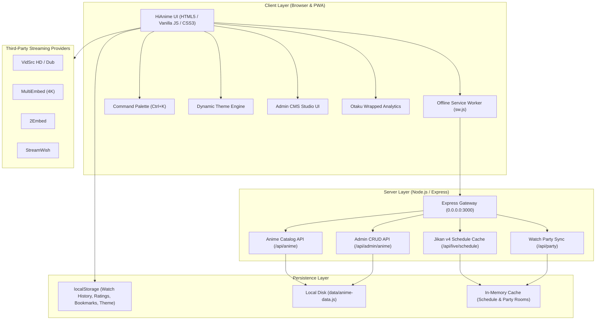

# HiAnime LocalWeb v5.0 Enterprise

🌐 **Live Web App (GitHub Pages)**: [https://hubg50we.github.io/localweb/](https://hubg50we.github.io/localweb/)

[](https://github.com/Hubg50we/localweb/actions/workflows/ci.yml)
[](https://hubg50we.github.io/localweb/)
[](https://nodejs.org/)
[](https://www.docker.com/)
[](LICENSE)

> Full-scale Enterprise anime streaming and CMS platform with a 50+ show catalog, `Ctrl+K` Command Palette, Dynamic Neon Theme Engine, in-app Admin Studio CMS, Otaku Wrapped Analytics, Offline PWA Service Worker, Docker containerization, and GitHub Actions CI/CD automation.


---

## 🏛️ System Architecture



---

## 🚀 Key v5.0 Enterprise Features

### 1. Global Command Palette (`Ctrl+K` / `Cmd+K`)
- Instant keyboard-driven modal accessible anywhere via <kbd>Ctrl+K</kbd>, <kbd>Cmd+K</kbd>, or the navbar badge.
- Fuzzy search across the **54+ catalog titles** to immediately launch the player.
- **Quick Action commands**: "Toggle Lights Off", "Toggle Theater Mode", "Open Watchlist", "Surprise Me / Random Anime", "Export Backup", "Switch Theme", "Open Admin Studio", and "Otaku Wrapped Stats".
- **Navigation filters**: Instant filtering for Movies, Top Airing, Completed, and live TV schedules.
- Full keyboard control (<kbd>↑</kbd> / <kbd>↓</kbd> to navigate, <kbd>Enter</kbd> to execute, <kbd>ESC</kbd> to close).

### 2. Dynamic Neon Theme Engine & Customizer
- Powered by dynamic CSS custom properties (`--accent-primary`, `--accent-glow`, `--bg-surface`).
- **5 instant presets** switchable from the Profile dropdown or Command Palette:
  - 🌸 **Sakura Pink** (`#ffbade`) — Signature HiAnime look
  - 🔴 **Cyberpunk Crimson** (`#ff2a5f`) — High-energy neon
  - ⚡ **Electric Cyan** (`#00f0ff`) — Sci-Fi futuristic
  - 🔮 **Gojo Purple** (`#9d4edd`) — Jujutsu dark domain
  - ☀️ **Solar Gold** (`#ffbe0b`) — Warm golden radiance
- Automatically saved to `localStorage` (`hianime_theme`) and restored on load.

### 3. Built-In Admin Studio / CMS Modal
- Manage your catalog without editing code!
- **Catalog Manager**: Live searchable data table of all shows with instant edit and delete actions (`DELETE /api/admin/anime/:id`).
- **Add / Edit Show Form**: Create custom shows or modify metadata with auto-generated multi-server embed URLs (`POST /api/admin/anime`, `PUT /api/admin/anime/:id`).
- **Hero Spotlight Manager**: 1-click toggles for which anime appear in the homepage Hero Carousel.
- Real-time disk synchronization (`data/anime-data.js`).

### 4. User Analytics & Otaku Wrapped Dashboard
- Visual personal analytics modal computed dynamically from your viewing history:
  - **Total Episodes Watched** & **Estimated Watch Time** (hours).
  - **Top Favorite Genres** rendered with animated CSS percentage progress bars.
  - **Completion Rate %** and **Watch Streak**.
  - **Otaku Rank Badges**: From *Genin Rookie* to *Anime Hashira*.

### 5. Full Offline PWA Service Worker (`/sw.js`)
- Complete Progressive Web App with service worker caching:
  - **Stale-While-Revalidate**: Instant loading for app shell (`/`, `/style.css`, `/app.js`, `/manifest.json`).
  - **Network-First with Cache Fallback**: Seamless offline catalog browsing for `/api/anime` and `/api/live/schedule`.

### 6. Synchronized Watch Party Rooms
- Create private rooms (`?party=<roomId>&anime=<id>&ep=<ep>`).
- Built-in real-time side-chat and host episode playback synchronization.

### 7. Interactive Community Feed & Timestamp Bookmarks
- 1–5 Star Rating widget persisted per show.
- Scene bookmarking with custom notes.
- Episode discussion feed with spoiler blur tags (click to reveal) and like counters.

---

## ⌨️ Global Keyboard Shortcuts

| Shortcut | Action |
|:---:|:---|
| <kbd>Ctrl+K</kbd> / <kbd>Cmd+K</kbd> | Open Global Command Palette |
| <kbd>N</kbd> | Next Episode |
| <kbd>P</kbd> | Previous Episode |
| <kbd>L</kbd> | Toggle Lights Off Mode |
| <kbd>T</kbd> | Toggle Theater Mode |
| <kbd>Esc</kbd> | Dismiss Overlays, Modals, or Lights Off |

---

## 🐳 Docker Deployment

Run anywhere with Docker in a single command:

```bash
# Build the production Docker image
docker build -t hianime-enterprise .

# Run container on port 3000
docker run -d --name hianime -p 3000:3000 hianime-enterprise
```

Check container health:
```bash
docker inspect --format='{{json .State.Health.Status}}' hianime
```

---

## ☁️ Cloud Deployment Blueprints

### 1. Render (`render.yaml`)
1. Create a Web Service on [Render](https://render.com/).
2. Connect `https://github.com/Hubg50we/localweb`.
3. Render automatically reads `render.yaml` (`npm install` -> `npm start`).

### 2. Railway (`railway.json` & `Procfile`)
1. In [Railway](https://railway.app/), click **New Project** → **Deploy from GitHub repo**.
2. Select `Hubg50we/localweb` for zero-configuration instant deployment.

---

## 🧪 Automated Testing & CI/CD

Run the 21-point automated verification suite locally:
```bash
npm test
```

Continuous Integration is automated via **GitHub Actions** ([`.github/workflows/ci.yml`](.github/workflows/ci.yml)), which validates syntax, boots the server, and runs the test suite on every push and pull request to `main`.

---

## 📄 License

MIT License. Designed with the HiAnime dark-neon aesthetic.
